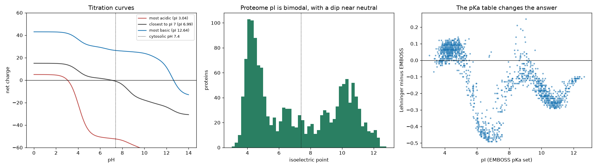

# Protein Isoelectric Point Calculator

> The pI your tool reports depends on which textbook its pKa values came from.

## Demo Output



Produced from a simulated proteome by `demo.py`: titration curves for an acidic, a near-neutral and a basic protein, the bimodal pI distribution, and how much two common pKa sets disagree.

The dip near pH 7 comes from chemistry, not biology. Few groups titrate between pH 6.5 and 8 (only histidine, cysteine and the N-terminus), so the titration curve is steep there. A small change in composition moves the pI straight across that range, so few proteins end up with a pI in it.

## Why This Exists

Isoelectric point drives 2-D gel positions, ion-exchange chromatography and protein solubility. Calculating it is simple: add up the Henderson-Hasselbalch charges of every ionisable group and find the pH where the total is zero. The catch is the input. Published pKa sets differ by up to about a pH unit for some groups, and those differences propagate. This repo makes every step visible.

## How It Works

| Step | Detail |
|------|--------|
| Charged groups | N-terminus, C-terminus, K, R, H (positive); D, E, C, Y (negative) |
| Charge per group | Henderson-Hasselbalch fraction protonated at a given pH |
| pI | Bisection between pH 0 and 14 (net charge falls monotonically with pH) |
| Molecular weight | Sum of average residue masses + one water |

```python
from pi_calc import isoelectric_point, net_charge, molecular_weight
isoelectric_point("MKWVTFISLLLLFSSAYS", pka_set="Lehninger")
```

## When NOT to Use This

- **Folded proteins.** Buried or interacting residues have shifted pKa values. Sequence-based pI ignores 3-D structure.
- **Post-translational modifications.** Phosphorylation adds negative charge, and other modifications shift pKa values. None of that is modelled here.
- **Precise IEF predictions.** Use tools calibrated on experimental data (for example IPC 2.0).

## The Uncomfortable Truth

Two decimal places on a calculated pI is false precision. Report the pKa set, and treat differences under about 0.3 as noise.

## Further Reading

- Kozlowski L. P. "IPC — Isoelectric Point Calculator." Biology Direct (2016).
- Bjellqvist B. et al. "The focusing positions of polypeptides in immobilized pH gradients can be predicted from their amino acid sequences." Electrophoresis (1993).
- Schwartz R., Ting C. S. & King J. "Whole proteome pI values correlate with subcellular localizations of proteins for organisms within the three domains of life." Genome Research (2001).
